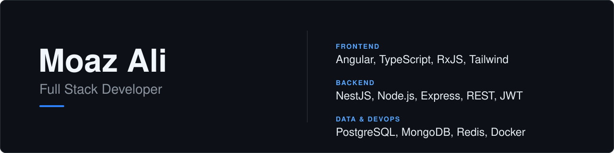
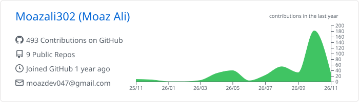
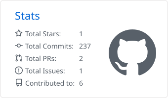
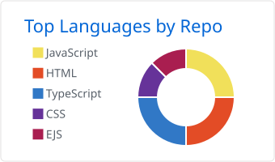
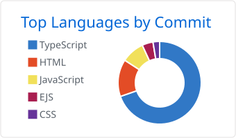

  

  
  
  

## About

I'm a full stack developer in Lahore, working mostly with Angular and NestJS. I've been building production apps for about a year, and most of what I know came from fixing things that broke in real use.

- At **Soletechs**, I work on a multi-portal ticketing system (Angular, ag-Grid) that runs in English and Arabic.
- At **FlyAviation Travel**, I built an internal CRM from the database up (Angular, NestJS, PostgreSQL, Redis).
- On my own, I'm building **Taleem Hub**, a multi-tenant school management platform.

I'm open to Angular and full stack roles, remote or in Lahore.

## Tech stack

  
   
  

## Featured projects

| Project | What it is | Stack |
|---|---|---|
| **[Taleem Hub](https://github.com/Moazali302/REPO_NAME)** | Multi-tenant school management platform with four portals (Super Admin, School Admin, Teacher, Student) and separate data for each school. | Angular, NestJS, PostgreSQL, Docker |
| **[Portfolio](https://github.com/Moazali302/Muaz_Portfolio)** | My portfolio. Angular 20 frontend and a custom REST API that serves projects, experience and blog posts. English and Urdu (RTL). [Live](https://moaz-ali-portfolio.vercel.app) | Angular, Tailwind, Express, MongoDB |
| **FlyAviation CRM** | Internal CRM for a travel agency: OTP login, role-based access, paginated bookings, dashboard. Company project, so the code is private. | Angular, NestJS, PostgreSQL, Redis |

## GitHub activity

  <picture>
    <source media="(prefers-color-scheme: dark)" srcset="./profile-summary-card-output/github_dark/0-profile-details.svg">
    
  </picture>
  <picture>
    <source media="(prefers-color-scheme: dark)" srcset="./profile-summary-card-output/github_dark/3-stats.svg">
    
  </picture>

  <picture>
    <source media="(prefers-color-scheme: dark)" srcset="./profile-summary-card-output/github_dark/1-repos-per-language.svg">
    
  </picture>
  <picture>
    <source media="(prefers-color-scheme: dark)" srcset="./profile-summary-card-output/github_dark/2-most-commit-language.svg">
    
  </picture>

